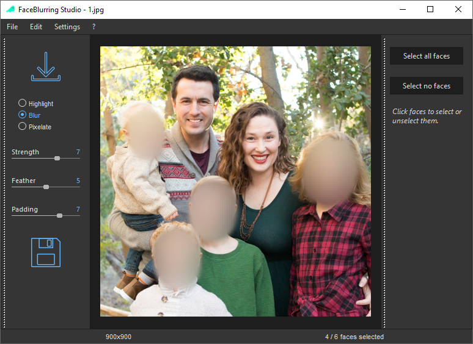
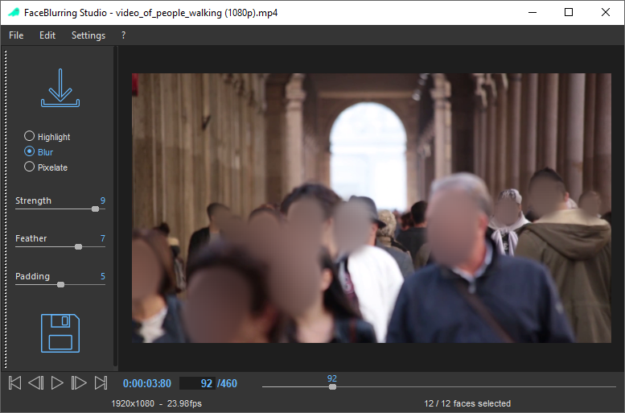
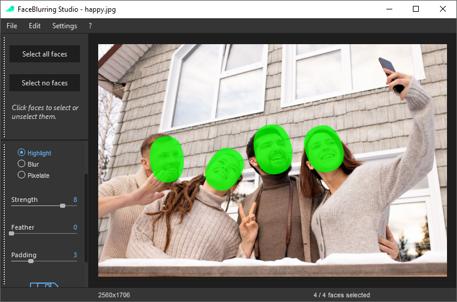
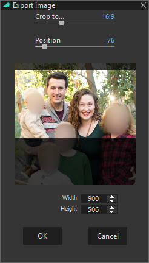
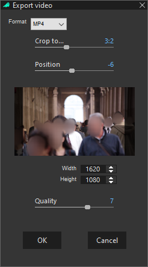
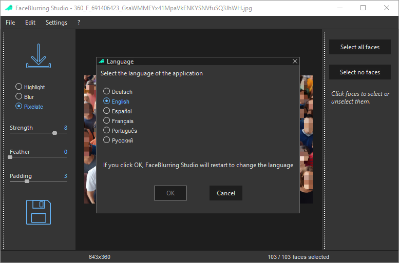

# FaceBlurring Studio

Free AI-powered face blurring for photos and videos.

FaceBlurring Studio automatically detects faces in images and videos and lets you blur, pixelate or highlight them in just a few clicks.

Unlike many online tools, all processing is performed locally on your computer. Your images and videos never leave your machine.

---

## Features

✅ Automatic AI face detection

✅ Blur, pixelate or highlight faces

✅ Process both images and videos

✅ Select all faces automatically

✅ Fine-tune the result by selecting or unselecting individual faces

✅ Local processing (no cloud upload)

✅ Multi-language user interface

✅ Fast and easy to use

✅ Up to thouthands of faces

---

## Typical Workflow

1. Open an image or a video
2. Let the AI detect faces automatically
3. Select all faces or none
4. Adjust individual faces with a simple click
5. Export the final result

---

## Use Cases

- Privacy protection
- Social media publishing
- Research datasets
- Education and training material
- Journalism
- Public demonstrations and presentations
- GDPR-compliant anonymization

---

## Screenshots

### On images

### On videos

### Smooth and accurate face masking

### Image export

### Video export

### Languages

---

## Download

Download the latest version here:

https://github.com/bertolin/FaceBlurringStudioRelease/releases/download/v2.1.1/FaceBlurring-Studio-Setup.exe
---

## System Requirements

- Windows 10 or Windows 11
- 64-bit system

---

## Technologies

- OpenCV
- ONNX Runtime
- YOLOFaceOnnx Detection
- wxWidgets

---

## Authors

Pascal Bertolino

Vincent Girondel

Developed in collaboration with GIPSA-Lab, Université Grenoble Alpes, France

---

## License

FaceBlurring Studio is distributed as freeware.

Please refer to the license supplied with the application.
